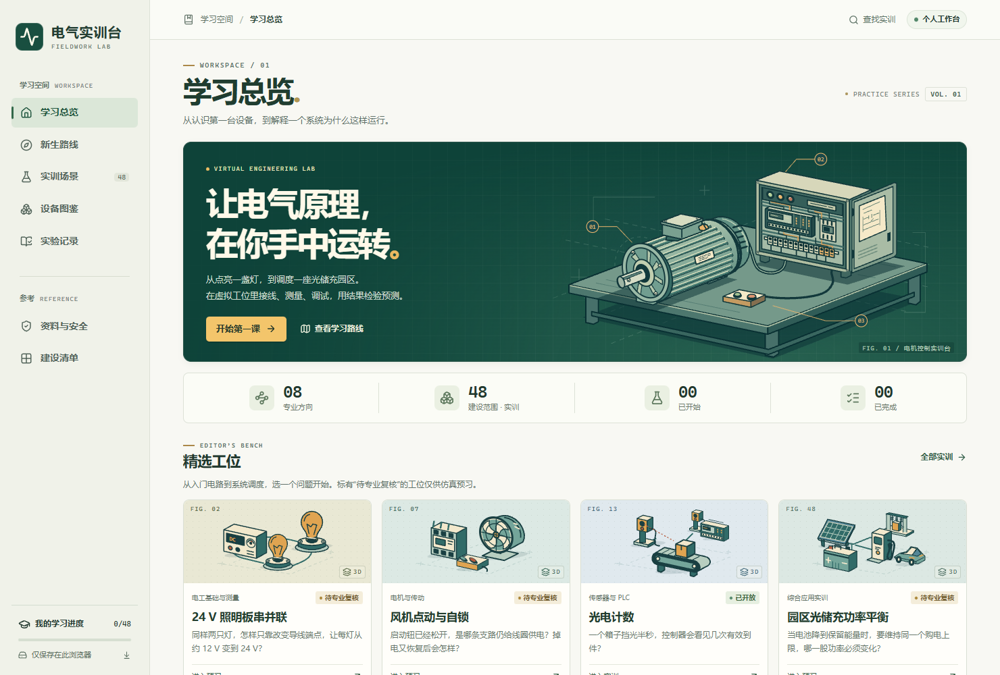

# 电气实训台 · Fieldwork Lab

一个给电气工程及其自动化学生的中文虚拟工位。先判断，再接线、设参或修改控制逻辑；设备、原理图、仪表、曲线和事件记录一起响应。无需登录，没有硬件接口、遥测或云端存档。

**[打开在线实训台](https://yangwei251003.github.io/dianqi-practice-lab/)** · [新生路线](https://yangwei251003.github.io/dianqi-practice-lab/#/route) · [查看全部建设状态](https://yangwei251003.github.io/dianqi-practice-lab/#/build)



## 从哪里开始

- **入门**：01 开工判断 → 02 照明板 → 03 端子追线 → 04 万用表 → 07 自锁 → 13 光电计数。
- **进阶**：运行点不是铭牌值：试 12 离心水泵。占空比不是实际输出：比较 26、27。功率和能量不是一回事：试 35、48。
- **动手**：在三维工位选择、操作热点，或使用等价键盘控件。02、03 的端子可以逐对插拔，16、18 可编辑教学梯形图。仿真时钟可暂停、单步或快进。
- **过关**：留下预测，依次达成操作目标，解释观察结果，再在独立工况提交迁移结果。预测错了不会清除实验；错因保存在自己的记录里。
- **学习记录**：状态仅存于当前浏览器的同源存储。到“实验记录”导出版本化 JSON，再在另一浏览器确认导入。切换域名、清理站点数据、无痕窗口或设备损坏都可能导致本地记录不可用。实验报告可打印或另存 PDF。

## 运行

需要 Node.js 24 与 npm：

```sh
npm ci
npm run dev
```

打开终端显示的本机地址。生产预览使用 `npm run build` 和 `npm run preview -- --port 4187`。依赖下载需要联网；一旦安装，本地工位不依赖外部模型、字体、图片服务器或设备。厂家资料链接需要联网。网站不是已安装的离线 PWA。

## 建设与验证

八个方向分别为：电工基础、电机传动、传感与 PLC、发输变配与保护、电力电子、新能源储充、建筑交通、综合实训。每个方向六项；每一项都单列设备型号、原始资料、实操目标、错误/故障/迁移案例和模型限制。

- [逐项实训、资料、模型和专业复核清单](docs/COURSES.md)
- [验证方法与实际结果](docs/VALIDATION.md)
- [公开网址复测：照明板、自锁、光电计数、继保和光储充五个工位](evidence/public-smoke.json)
- [许可、素材及第三方归属](docs/ATTRIBUTION.md)

“已开放”表示当前版本的虚拟任务达到技术验收且不要求额外安全签核；**不代表经过现场验证**。需要资质人员签核的工位仅作预习，在建设清单中分开列出，不计入正式开放。每次修改模型或操作后都应重新验收。

## 扩充

课程定义在 `src/content`，契约在 `src/core/types.ts`。新增或修订场景时同步添加有版本或查阅日期的设备证据、状态转移或物理模型、可操作部件、原理图、原创分镜、预测/解释、可复现的四类检验和主线过关序列。补充对应三维缩比场景与漫画构图后，再做浏览器验收。

```sh
npm test
npm run build
npm run audit:content
npm run test:browsers
```

浏览器检查针对已在端口 4187 运行的生产预览；环境变量 `LAB_URL` 可换目标，`LAB_ENGINES` 可选 `chrome,edge,firefox,webkit`。Chrome 和 Edge 需要安装相应正式版，Firefox 通过 WebDriver BiDi，非默认路径使用 `FIREFOX_PATH`。WebKit 先执行 `npx playwright install webkit`。不能在不支持 WebGL 的平台把二维降级计为三维通过。

## 公开范围

仓库保留完整应用源码、锁文件、自制图件、测试和可公开的验收证据。Pages 从源码构建 `dist`；依赖目录、临时构建物、原始私人提示、浏览器资料和个人实验记录不属于发布内容。本项目不是操作许可、设备数字孪生或安全认证系统。
