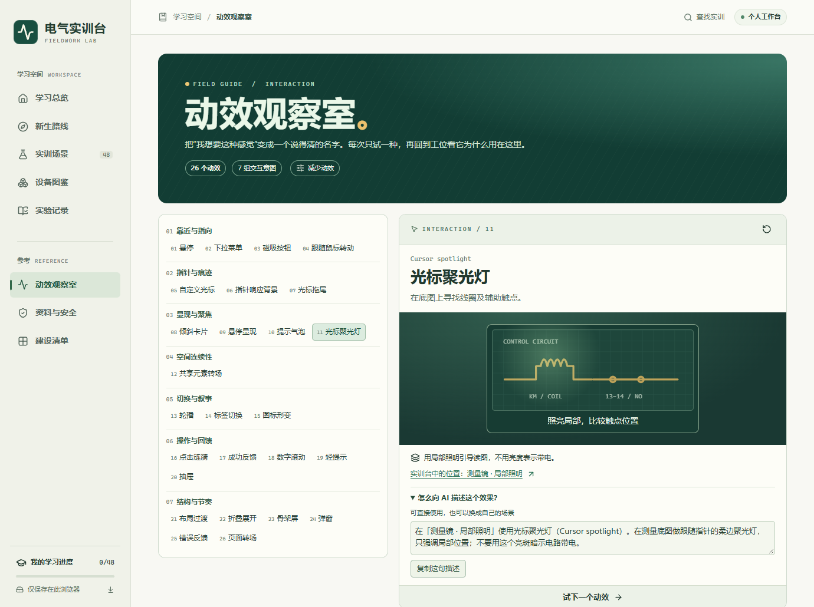

# 动效观察室：先看效果，再叫出它的名字

**[动手试 26 种](https://yangwei251003.github.io/dianqi-practice-lab/#/motion)**。选一个名称，先按指示做一次，再点「实训台中的位置」；网页会把对应控件滚入视野。点「怎么向 AI 描述这个效果？」可以复制一条针对当前效果的具体要求。不支持自动复制时会选中文字，不假报复制成功。

以下中文名称按[原视频](https://www.douyin.com/video/7709126118539873587)约 00:32 总览的阅读顺序列出。英语是可用于搜索或描述的常见表达，不是唯一译名。站内分组按教学意图调整；示例、文案和实现不是视频素材。

| 名称 | 英文关键词 | 在实训台看哪里、看什么 |
|---|---|---|
| 01 悬停 | Hover | 场景入口先给选中线索，不因指针经过就启动设备。 |
| 02 下拉菜单 | Dropdown | 目录的「快速跳站」就地列出入口；Esc 可收起。 |
| 03 磁吸按钮 | Magnetic button | 首页「开始第一课」的字与箭头靠近指针，点击区域不动。 |
| 04 跟随鼠标转动 | Rotate to cursor | 取样手记的测量镜指向观察位置；不是表针读数。 |
| 05 自定义光标 | Custom cursor | 进入测点区变成准星，离开恢复默认。 |
| 06 指针响应背景 | Pointer-reactive background | 首页网格微移，正文与导航留在原位。 |
| 07 光标拖尾 | Cursor trail | 测量镜的指针余迹很快消退，不表示电流。 |
| 08 倾斜卡片 | Tilt card | 指向工位卡四角，只有卡片小幅倾斜。 |
| 09 悬停显现 | Hover reveal | 工位插图浮现入口提示；课程名称、状态不靠悬停才能看到。 |
| 10 提示气泡 | Tooltip | 测点说明支持悬停、聚焦或点击，解释定格的范围。 |
| 11 光标聚光灯 | Cursor spotlight | 局部照明帮助指认底图；不把高亮误作通电。 |
| 12 共享元素转场 | Shared element transition | 支持该能力的浏览器中，工位卡标题接续成工位页标题。 |
| 13 轮播 | Carousel | 「逐格读漫画」手动翻格，不自动翻走。 |
| 14 标签切换 | Tabs | 同一工况切换设备、原理和数据；动画不是另一套独立数据。 |
| 15 图标形变 | Icon morph | 原理演示的播放键与暂停键共用位置。 |
| 16 点击涟漪 | Ripple | 点按取样的确切位置给出一次反馈，不伪装为成功。 |
| 17 成功反馈 | Success feedback | 判断正确后出现勾号与解释，成功不只靠颜色。 |
| 18 数字滚动 | Number roll | 搜索或筛选结果数量滚入新值；实时仪表不做数字补间。 |
| 19 轻提示 | Toast | 实际写入笔记之后提示，消失后原始数据仍可读。 |
| 20 抽屉 | Drawer | 取样手记在侧栏并排比较定格测量，装置继续运行。 |
| 21 布局过渡 | Layout transition / FLIP | 筛选时保留的卡片从旧位置移到新位置，可跟住同一张卡。 |
| 22 折叠展开 | Accordion / disclosure | 随时打开先修、学习目标及操作说明。 |
| 23 骨架屏 | Skeleton | 三维模块的真实加载提示；仅观察室提供标明用途的慢网实验。 |
| 24 弹窗 | Modal dialog | 重做前集中确认，取消或 Esc 保留记录并返回触发按钮。 |
| 25 错误反馈 | Error feedback | 预测或解释有误时短促提醒，并给出可核对的理由。 |
| 26 页面转场 | Page transition | 常规导航轻量过渡，离开实时画布不截取画布做装饰。 |

## 先练会描述，而不是堆形容词

一个可复用的句式：**在什么对象上 → 什么触发 → 哪一部分怎样变化 → 什么时候停 → 哪些东西绝不能跟着动**。例如：「给启动键做磁吸：指针靠近时只让内层箭头微微偏向指针；移出回正。点击区域不要移动，触屏保持原样。」这比「给按钮做高级一点」更容易被实现和验收。

## 48 个工位：操作、仿真和动画是什么关系

| 工位 | 在三维中能观察什么（例） |
|---|---|
| 01–06 电工基础 | 区分仍可供压与实际有电流；比较双灯支路、追线脉冲、OL 和连续通路、电容储压与充放电反向、三相相位差。 |
| 07–12 电机传动 | 看实际吸合的线圈，不把按钮指令画成转向；对照磁场和转子、风机气流、末端供水和旁通回流。 |
| 13–18 传感与 PLC | 对照光束、传感输出、边沿计数；把液位、变送电流、定位移动、分拣到位与超时分开。 |
| 19–24 发输变配与保护 | 示意励磁、变压、压降和馈线受影响区域；23 的录波游标、TRIP 灯与 52a 合位反馈分开响应。 |
| 25–30 电力电子 | 彰显整流导通、滤波储能、变流器能量传递、H 桥方向、UPS 供能路径；标识是模型解释，不是真实开关波形。 |
| 31–36 新能源 | 随遮阴和跟踪算法看功率曲线及工作点；观察风能限幅、电池状态、储能与充电许可。 |
| 37–42 建筑交通 | 对照灯、阀、风量、门锁及信号相位；区分轨道制动能量被邻车吸收、被站旁回收和在车上耗散。 |
| 43–48 综合 | 把物流、污水、关键供电、冷链、堆垛位置和园区的多路能量交换分别显出来；不把停机和堵料都画成一直移动。 |

三维可切换「设备特写 / 整台全景」、「原理透视」，可放大演示屏。不同箭头和量柱的含义以**本课图例**为准，不代表真实粒子、实际尺度或真实传播速度；定格的光标轨迹更不是设备状态。曲线和仪表来自相同工况。正常的静止、断路或无流量应当静止。演示不是新存档；取样会标注「演示」或「实操」。减少动效不会改变物理计算，允许手动选段或单步观察。

工程入口：`src/core/cinema.ts`（每课有命名分段和输入），`src/visual/three/phenomena.ts`（通道、单位归一化和方向），`src/visual/three/field-layer.ts`（实例化绘制和三维仪器），`src/ui/motion-catalog.ts`（术语、描述与真实控件位置）。技术参考：[Three.js 的 InstancedMesh](https://threejs.org/docs/#api/en/objects/InstancedMesh)、[MDN 的元素动画接口](https://developer.mozilla.org/en-US/docs/Web/API/Element/animate)、[减少动态效果偏好](https://developer.mozilla.org/en-US/docs/Web/CSS/@media/prefers-reduced-motion)。另见[本轮三维与动效专项证据](MOTION-VALIDATION.md)及[专业复核边界](VALIDATION.md)。
